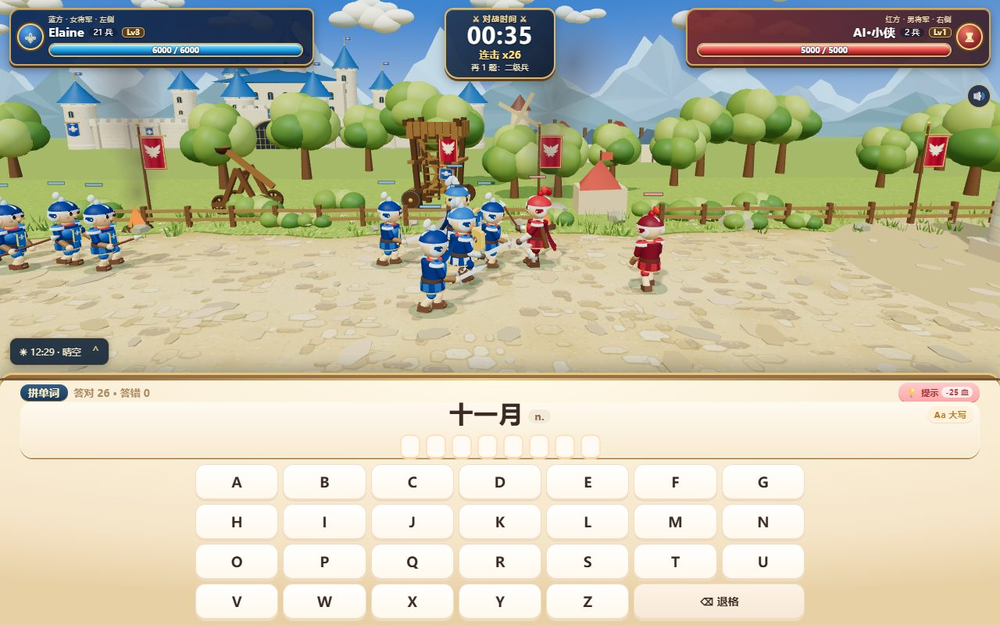
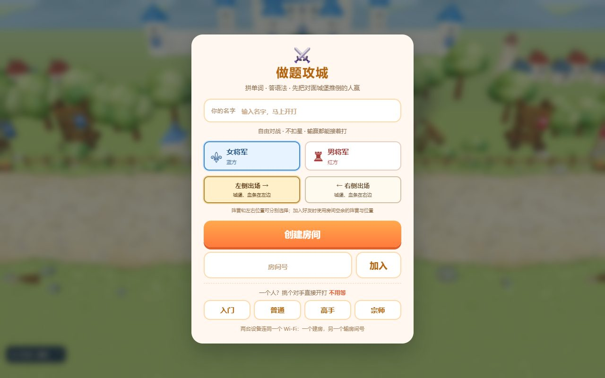
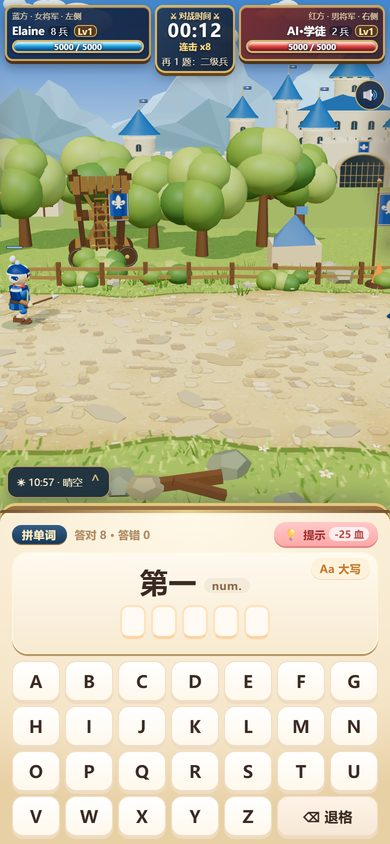

<div align="center">

# ⚔️ 做题攻城 · Castle Battle

**拼单词、答语法，答对了就出兵；先把对面城堡推倒的人赢。**

<sub>Answer questions to raise an army — knock the enemy castle down before they knock yours.</sub>

[](https://www.python.org/)
[](server.py)
[](js/pk/scene.js)
[](#快速开始)
[](#题库)



</div>

---

## 这是什么

一个用「做题」驱动即时战略的小游戏：每答对一道题，己方就多一个兵走向对面城堡；
答错连击清零、白丢一次机会。兵种、城堡血量、箭雨、方士全由**连击数**决定，
所以「答得又对又快」本身就是唯一的操作。

- **自带题库**：582 个拼写词 + 105 道语法题，开箱即用，也可以换成自己的词表。
- **自带服务器**：单文件 `server.py`，只用 Python 标准库，不用 `pip install` 任何东西。
- **能联机**：同一个 Wi-Fi 下两台设备建房 / 加入（4 位房间号），也可以一个人打四档 AI。
- **不依赖别的项目**：整个文件夹 copy 走就能跑，不读上层目录任何文件。

> 3D 战场用 Three.js 实时渲染，服务器以 20Hz 推进战斗（走位、近战结算、箭雨、城堡倒塌）。
> 客户端只负责「上报答对/答错」和「照着画」，所以**改了前端也骗不到血量**。

## 快速开始

需要 **Python 3.7+**（Windows 装 Python 时记得勾 *Add Python to PATH*）。

```bash
git clone https://github.com/jacwuha-lang/castle-battle.git
cd castle-battle
```

| 系统 | 怎么启动 |
| --- | --- |
| Windows | 双击 `start.bat` |
| macOS / Linux | `./start.sh` |
| 都会 | `python server.py` |

启动后浏览器自动打开 <http://127.0.0.1:8788/index.html>，输入名字就能开打。

> ⚠️ **不能直接双击 `index.html`**：页面是 ES Module，`file://` 协议会被浏览器拦掉，
> 必须由 `server.py` 提供 HTTP 服务（联机同步也依赖它）。

## 玩法

<table>
<tr><td width="50%"></td>
<td width="50%"></td></tr>
<tr><td align="center"><sub>大厅：填名字、选阵营和出场位置</sub></td>
<td align="center"><sub>手机端：竖屏也能完整开打</sub></td></tr>
</table>

### 一局怎么打

1. 看题 —— 约 **6 成拼单词**（给中文和词性，逐个字母敲）、**4 成语法选择**。
2. 右下角「提示」看得起就买：**扣 25 点城堡血**，每题最多 2 次。
3. 答对出兵、连击 +1；答错连击清零，这一次就白打了。
4. 城堡血量归零，或者 **6 分钟**到时血多的一方赢。

### 连击奖励表

| 连击 | 奖励 |
| :--- | :--- |
| 每答对 1 题 | 出 1 个兵 |
| 3 的倍数 | 这次出**二级兵** |
| 8 的倍数 | 这次出**三级兵** |
| 20 的倍数 | 这次出**武将** |
| 5 的倍数 | 自家城堡**回血** |
| 10 的倍数 | 城堡**升级**（血量上限提高），并额外白送 1 个**方士** |
| 15 的倍数 | 自家城堡放一次**箭雨**，扫对面一片 |

同时踩中多个档位取最高的：`24 = 3×8` → 三级兵，`40 = 8×20` → 武将。

### 兵种

| 兵种 | 血量 | 攻击 | 防御 | 命中 | 闪避 | 格挡 | 暴击 | 移速 |
| :--- | ---: | ---: | ---: | ---: | ---: | ---: | ---: | ---: |
| 一级兵 | 20 | 2 | 2 | 60% | 10% | 10% | 10% | 1.55 |
| 二级兵 | 40 | 4 | 4 | 70% | 20% | 20% | 15% | 1.65 |
| 三级兵 | 60 | 6 | 6 | 80% | 30% | 30% | 20% | 1.75 |
| 武将 | 80 | 10 | 10 | 90% | 30% | 30% | 25% | 1.95 |
| 方士（远程） | 同三级兵 ×0.5 | — | — | — | — | — | — | 射程翻倍，一次最多打 3 个 |

## 两种打法

### 一个人：四档 AI

大厅底部 **入门 / 普通 / 高手 / 宗师**，点了就直接开局，不用等。

AI 走的是和真人**完全相同**的一条结算路径（同一个 `do_answer`），
只是它自己按节奏「答题」：连击越高越手忙脚乱，答错率也跟着涨，
所以它没法一口气连到 60 刷武将 —— 那是人打出来的成绩。

### 两个人：同一 Wi-Fi 联机

1. 两台设备连同一个路由器（或同一个手机热点）。
2. A 设备启动游戏，命令行会打印一行：

   ```
   LAN:     http://192.168.31.118:8788/index.html   <- open this on the other device
   ```

3. B 设备浏览器打开这个地址。
4. A 点「创建房间」拿到 **4 位房间号**，B 输房间号点「加入」，开局。

不需要外网、不需要账号。房间只在内存里，服务器关掉就清空。

## 题库

全部在 [`data/bank.js`](data/bank.js)，纯数据，直接改：

```js
// 拼写词：w 英文 / m 中文 / p 词性 / tier 难度 1–4
{ w: "apple", m: "苹果", p: "n.", tier: 1 }

// 语法题：q 题干 / o 四个选项 / a 正确项下标（从 0 开始）/ tip 讲解
{ q: "He ___ a student.", o: ["am", "is", "are", "be"], a: 1, tip: "第三人称单数用 is。" }
```

当前 **582 词 + 105 题**，覆盖 be 动词、三单、时态、名词复数、冠词、介词、代词、
疑问词、there be、比较级等小学段高频点。出题逻辑在
[`js/pk/questions.js`](js/pk/questions.js)：约 6 成拼写、4 成语法，不连着出同一题型。

## 目录

```
castle-battle/
├─ index.html              页面：大厅 / 战场 / 结算
├─ start.bat / start.sh    一键启动（纯英文输出，避免控制台编码问题）
├─ server.py               独立服务：静态托管 + 房间 + 20Hz 战斗推进 + AI
├─ pk_combat_geometry.py   近战距离与站位计算
├─ data/bank.js            题库（词表 + 语法题）
├─ js/pk/
│  ├─ main.js              流程：大厅 → 对战 → 结算
│  ├─ net.js               长轮询同步（含断线重连）
│  ├─ questions.js         出题
│  ├─ sfx.js               音效（WebAudio 合成，无音频文件）
│  ├─ scene.js + scene/    3D 战场：地形、天气、箭雨、倒塌、镜头
│  └─ model/               城堡、兵种、武器、盔甲、姿势混合
├─ css/                    样式（大厅 / 战斗 / 氛围）
├─ vendor/three.module.min.js
└─ profiles/               按玩家名生成的档案（可随时删，自动重建）
```

## 常见问题

<details>
<summary><b>端口被占用怎么办？</b></summary>

```bash
python server.py --port 9000
```

局域网地址里的端口也会跟着变，用新的那个通知对方。
</details>

<details>
<summary><b>另一台设备打不开？</b></summary>

先确认两台在同一 Wi-Fi。Windows 首次运行会弹防火墙提示，要允许「专用网络」。
公司 / 酒店 Wi-Fi 常开了「客户端隔离」，设备之间互相访问不了 —— 这种情况用手机热点最省事。
</details>

<details>
<summary><b>手机上能玩吗？</b></summary>

能。竖屏下战场在上、题目和虚拟键盘在下，`390×844` 实测可完整打一局。
</details>

<details>
<summary><b>想恢复「报名费 / 赢家奖金」的星星记账？</b></summary>

`server.py` 里把 `PK_ENTRY` / `PK_WIN_BONUS` 从 `0` 改回 `50` / `75`，
再让客户端显示余额即可。独立版默认不记账，打开就能一直打。
</details>

<details>
<summary><b>控制台那些中文日志正常吗？</b></summary>

正常，是服务器在报告房间状态（谁进了房、AI 开工）。启动横幅和报错都做了英文处理，
只有在 Windows 用 GBK 控制台看中文日志可能显示乱码，不影响运行。
</details>

## 技术说明

- **战场由服务器裁决**：`server.py` 以 `PK_TICK = 0.05`（20Hz）推进所有单位，
  客户端拿到的是一帧帧快照，前端改数字改不出优势。
- **同步用长轮询**：`GET /api/pk/sync` 带版本号挂起，有变化立刻返回，无变化超时再重连；
  比 WebSocket 少一层依赖，穿透一般代理也更稳。
- **模型全是代码生成**：没有 glTF/贴图文件，城堡、兵种、盔甲、布料都在 `js/pk/model/` 里用几何体拼，
  所以整个仓库只有 1MB 出头。音效同理，`sfx.js` 用 WebAudio 现场合成。
- **AI 与真人同一条代码路径**：`bot_step()` 只是按节奏调用 `do_answer()`，
  出兵、连击、回血、升级、箭雨一行都不另写。

## 截图

| | |
| :---: | :---: |
|  |  |
| 26 连击，兵线压过去了 | 大厅：阵营、出场位置、房间号 |
|  | |
| 手机竖屏 | |

---

<sub>从「Elaine 学英语」里拆出来的独立版本，原项目里它只是其中一个模块。题库面向小学段英语，也可以整个换成别的学科。</sub>
